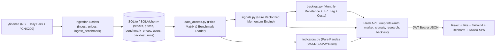
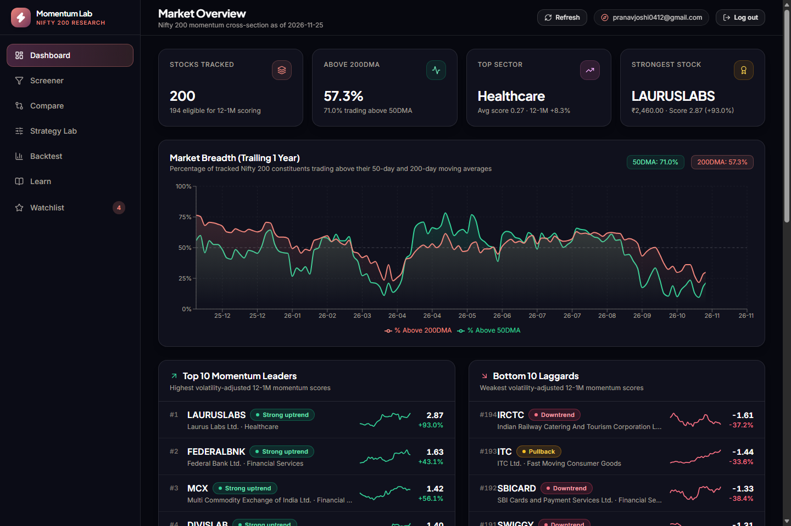
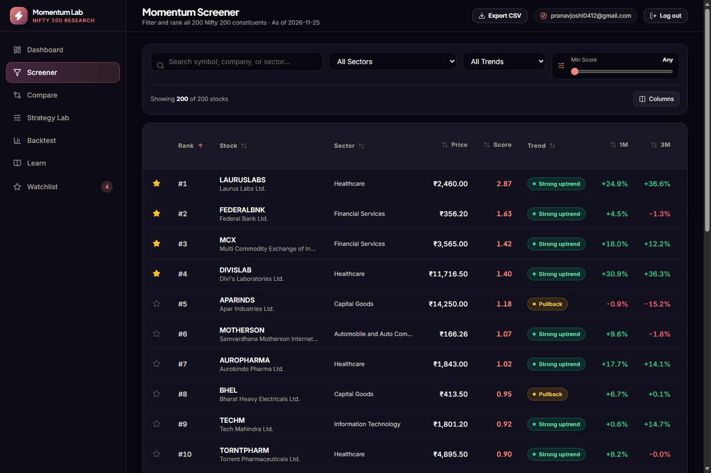
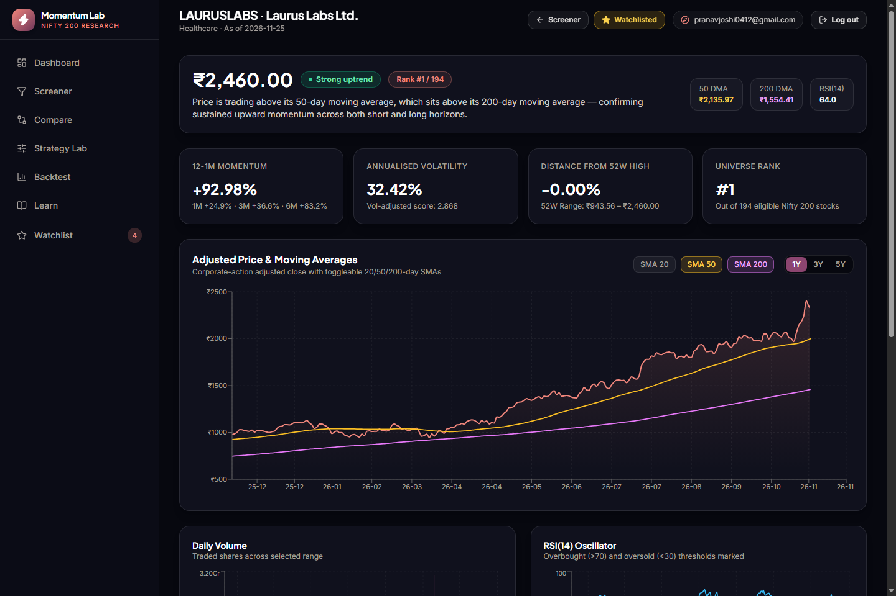
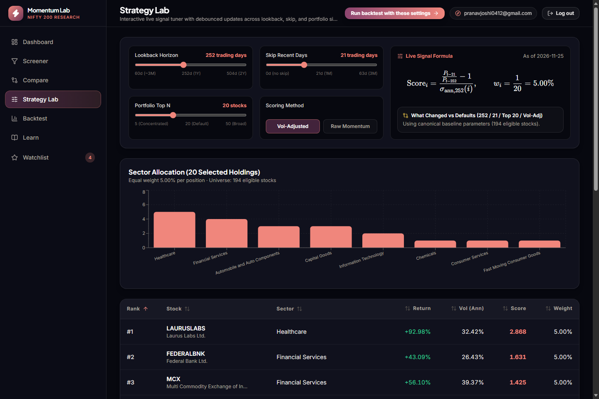
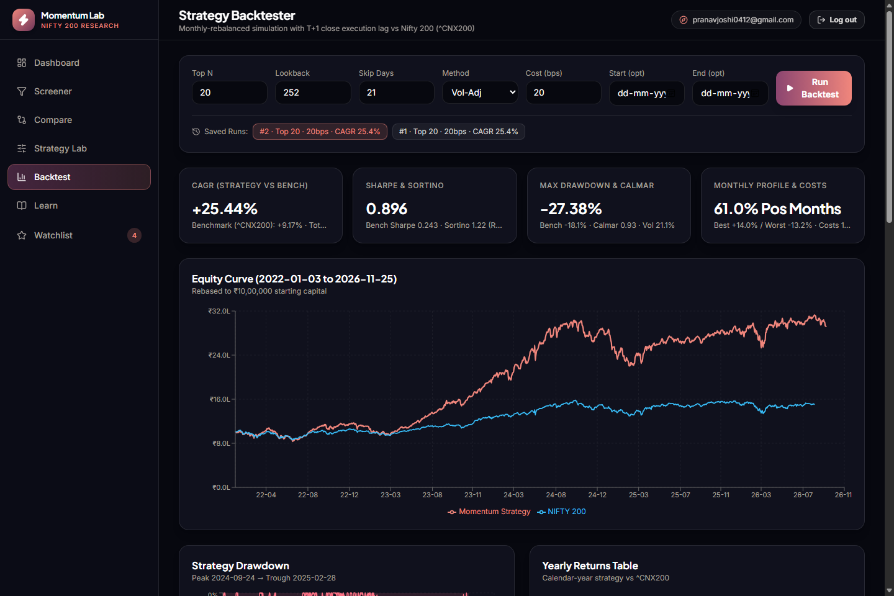
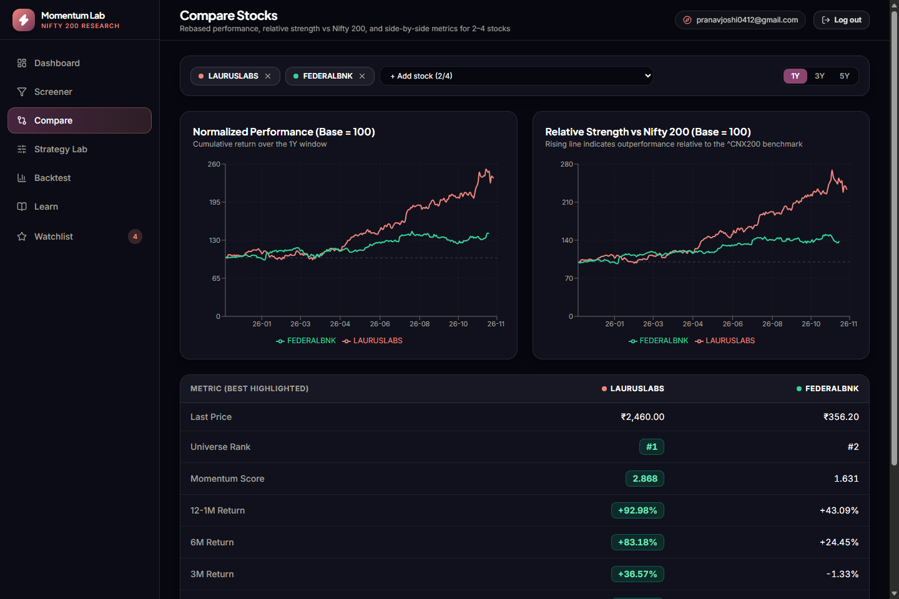
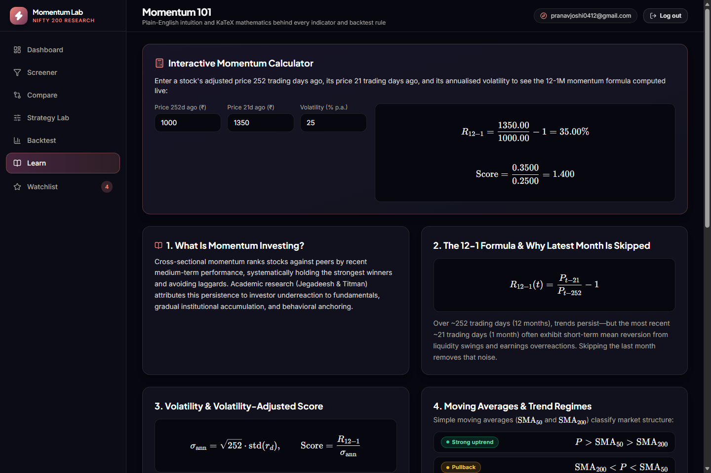
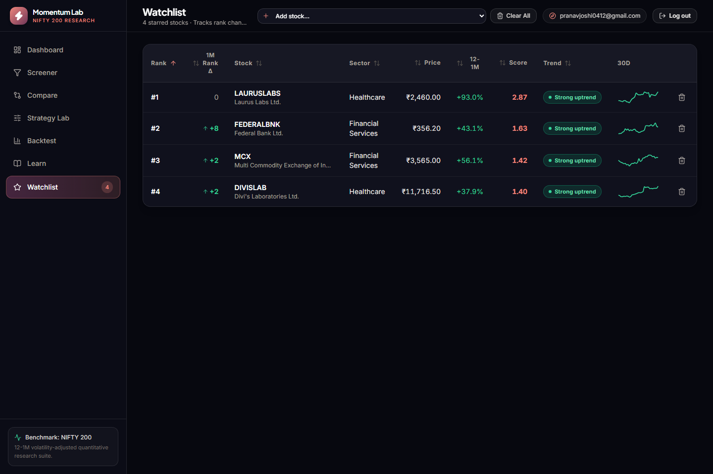

# Momentum Investment

A full-stack quantitative momentum research platform and authentication portal for the NSE Nifty 200 universe, featuring live NIFTY 500 market insights, technical indicators, cross-sectional screening, strategy simulation, and historical backtesting.

## Features

- **Market Overview (`/dashboard`)**: Live breadth chart (% above 50/200DMA), KPI cards, Top 10 & Bottom 10 momentum lists with 30-day sparklines, and an interactive sector momentum heatmap.
- **Momentum Screener (`/screener`)**: Full 200-stock sortable & paginated table with search, sector & trend-regime filters, minimum-score slider, toggleable columns, CSV export, and `localStorage` watchlist stars.
- **Stock Deep-Dive (`/stock/:symbol`)**: Interactive price chart with SMA 20/50/200 toggles and `1y`/`3y`/`5y` range selector, volume & RSI(14) charts, plain-English trend verdict, monthly rank history, and step-by-step KaTeX score breakdown.
- **Stock Compare (`/compare`)**: Side-by-side normalized performance chart (`Base = 100`) and full indicator comparison for up to 4 stocks.
- **Strategy Lab (`/strategy-lab`)**: Real-time `/api/signals` explorer with adjustable lookback, skip window, top-N, and scoring method plus KaTeX formula preview.
- **Backtester (`/backtest`)**: Monthly-rebalanced historical simulation with `T+1` close execution lag, transaction cost modeling, benchmark comparison (`^CNX200`), drawdown & yearly return charts, and saved user runs.
- **Methodology & Watchlist (`/learn`, `/watchlist`)**: Interactive KaTeX quantitative reference and persistent watchlist view.

## Project Structure

```text
├── frontend/               # React + Vite + Tailwind CSS + Recharts + KaTeX
│   ├── public/
│   ├── src/
│   │   ├── components/     # AppLayout, DataTable, StatCard, TrendBadge, Sparkline, SectorHeatmap, MathFormula
│   │   ├── context/        # AuthContext (JWT session)
│   │   ├── hooks/          # useCachedApi (in-memory TTL cache), useWatchlist (localStorage)
│   │   ├── lib/            # API client & INR/percent/CSV formatters
│   │   └── pages/          # Dashboard, Screener, StockDetail, Compare, StrategyLab, Backtest, Learn, Watchlist
│   ├── .env.example
│   ├── index.html
│   └── package.json
├── backend/                # Flask API & NSE market data worker
│   ├── auth.py             # JWT authentication blueprint & login_required
│   ├── backtest.py         # Pure pandas/numpy monthly backtesting engine
│   ├── backtest_routes.py  # Protected /api/backtest and /api/backtests endpoints
│   ├── data/               # Nifty 200 universe CSV (nifty200.csv)
│   ├── data_access.py      # Database-to-DataFrame price & benchmark loaders
│   ├── indicators.py       # Pure pandas SMA, RSI(14), 52W high/low, relative strength, trend rules
│   ├── market_data.py      # Yahoo Finance fetcher & Redis/in-memory cache
│   ├── market_routes.py    # Protected /api/stocks and /api/prices endpoints
│   ├── models.py           # SQLAlchemy User, Stock, Price, BenchmarkPrice, BacktestRun
│   ├── research_routes.py  # Protected /api/screener, /api/market/overview, /api/stocks/<symbol>/analysis
│   ├── scripts/            # Universe, price, benchmark, signal, and backtest CLIs
│   ├── server.py           # Flask server and background refresh daemon
│   ├── signals.py          # Pure pandas/numpy momentum signal engine
│   ├── signals_routes.py   # Protected /api/signals endpoint
│   ├── tests/              # pytest test suite
│   ├── .env.example
│   └── requirements.txt
└── .gitignore
```

## Prerequisites

- **Node.js** (v18+ recommended) and **npm**
- **Python** 3.10+
- **Redis** (optional — the backend automatically falls back to an in-memory cache if Redis is unavailable)

## Setup & Running Locally

### 1. Backend

```bash
cd backend
python -m venv venv
# Windows (PowerShell):
.\venv\Scripts\Activate.ps1
# macOS/Linux:
# source venv/bin/activate

pip install -r requirements.txt
cp .env.example .env
# Edit backend/.env and set a random JWT_SECRET (for example: python -c "import secrets; print(secrets.token_hex(32))")
python server.py
```

#### Backend Environment Variables (`backend/.env`)

- `JWT_SECRET` (required) — Secret key used to sign HS256 JWT tokens (`24h` expiry)
- `DATABASE_URL` (optional, defaults to `sqlite:///momentum.db`) — SQLAlchemy database connection string

The API server runs on `http://localhost:8000` by default and exposes:
- `GET /` — API status and links
- `GET /api/nifty500` — NIFTY 500 index summary
- `GET /api/nifty500-details` — Index summary plus NSE top 5 gainers and losers
- `GET /api/cache-status` — Active cache mode (`redis` or `in-memory`) and TTL
- `POST /api/auth/signup` — Register with `{ email, password }` (returns `201` `{ token, user }`)
- `POST /api/auth/login` — Sign in with `{ email, password }` (returns `200` `{ token, user }`)
- `GET /api/auth/me` — Protected endpoint requiring `Authorization: Bearer <token>` (returns `200` `{ user }`)
- `GET /api/stocks` — Protected endpoint returning active stocks (`symbol`, `name`, `sector`)
- `GET /api/prices/<symbol>?from=YYYY-MM-DD&to=YYYY-MM-DD` — Protected endpoint returning daily adjusted OHLCV bars (defaults to the last 1 year)
- `GET /api/signals?as_of=YYYY-MM-DD&method=vol_adjusted&top=20&lookback=252&skip=21` — Protected endpoint returning momentum scores, rankings, and top selections as of a given date
- `GET /api/strategy/preview?lookback=252&skip=21&top=20&method=vol_adjusted` — Lightweight protected endpoint returning live Strategy Lab top-N portfolio, sector counts, and diff vs defaults
- `GET /api/screener` — Protected, cached endpoint returning full-universe indicators, returns, scores, ranks, rank changes, and trend labels
- `GET /api/stocks/<symbol>/analysis?range=1y|3y|5y` — Protected endpoint returning SMA/RSI/relative-strength series, monthly rank history, and step-by-step score breakdown
- `GET /api/market/overview` — Protected, cached endpoint returning top/bottom 10 momentum leaders, sector heatmap metrics, and breadth history
- `POST /api/backtest` — Protected endpoint validating parameters, running a monthly momentum backtest, saving a `BacktestRun`, and returning metrics, yearly returns, equity curve, and rebalances
- `GET /api/backtests` — Protected endpoint listing the logged-in user's saved backtest runs (headline metrics)
- `GET /api/backtests/<id>` — Protected endpoint returning the full saved backtest result (`404` if not found or owned by another user)

#### Historical Market Data Ingestion

From `backend/`, populate the Nifty 200 stock universe and download ~6 years of daily adjusted OHLCV history:

```bash
cd backend
python -m scripts.ingest_prices --full
```

Fetch only new trading days after each stock's latest stored date:

```bash
python -m scripts.ingest_prices --incremental
```

You can test with a subset of symbols using `--symbols RELIANCE.NS TCS.NS`.

#### Data Notes

- **Survivorship bias**: `backend/data/nifty200.csv` reflects today's Nifty 200 constituents rather than historical point-in-time index membership, so backtests using this universe are subject to survivorship bias.
- **Adjusted prices**: All daily OHLC prices are downloaded with `yfinance` `auto_adjust=True`, adjusting historical prices for stock splits, bonuses, and dividends so corporate actions do not create artificial price jumps.

#### Signal Methodology

The momentum engine (`backend/signals.py`) ranks the active Nifty 200 universe on any target date using pure vectorized `pandas`/`numpy` operations:

- **Momentum formula**: Trailing return over trading-day positions is computed as `price[as_of - skip_days] / price[as_of - lookback_days] - 1` (default `lookback_days = 252`, `skip_days = 21`, i.e., 12-1 month momentum).
- **Why the most recent month is skipped**: Short-term (1-month / ~21 trading day) returns exhibit mean reversion and microstructure noise; skipping the most recent month isolates intermediate-term trend continuation.
- **Volatility adjustment**: In `vol_adjusted` mode (default), raw momentum is divided by annualised daily return volatility (`std(daily_returns) * sqrt(252)` over the lookback window) so steady trends rank ahead of erratic high-beta spikes with the same return. `raw` mode ranks directly by raw momentum.
- **Eligibility rules**: Stocks must have at least `lookback_days + skip_days` valid trading-day rows strictly before the effective `as_of` date, valid positive prices at both `as_of - skip_days` and `as_of - lookback_days`, and a finite non-NaN score (NaN or zero-volatility scores under `vol_adjusted` are excluded, never filled). Ties in score are broken deterministically by symbol so ranks `1..N` have no duplicates.
- **No-look-ahead guarantee**: All inputs are sliced to rows with `date <= as_of` before any computation; if `as_of` falls on a weekend or market holiday, the last trading day on or before `as_of` is used.

Inspect the latest top 20 rankings from `backend/`:

```bash
cd backend
python -m scripts.show_top --method vol_adjusted
python -m scripts.show_top --method raw
```

#### Backtest Methodology

The historical simulator (`backend/backtest.py`) evaluates the signal engine with strict point-in-time discipline:

- **Rebalance rule**: Rebalance signals are generated at the close of the **last trading day of each calendar month** by calling `signals.compute_scores(..., as_of=rebalance_date)` on price rows `<= rebalance_date`. Rebalancing begins only at the first month-end with sufficient history (`lookback_days + skip_days` prior trading days).
- **Execution lag**: Trades execute at the **close of the next trading day** (`rebalance_date + 1`), never on the signal date itself. Between rebalances, share counts remain fixed and weights drift with prices.
- **Transaction costs**: A configurable proportional cost (`cost_bps`, default `20` bps = `0.20%` per unit of traded value) is applied to both buys and sells (`sum(|target_value - current_value|) * cost_bps / 10000`) and deducted from portfolio value at each rebalance.
- **Benchmark used**: **NIFTY 200 (`^CNX200`)**, ingested via `python -m scripts.ingest_benchmark` into `benchmark_prices` and rebased to the strategy's initial capital (`1,000,000` by default). If `^CNX200` is unavailable in the database, `/api/backtest` falls back to **NIFTY 50 (`^NSEI`)** and flags the fallback in the response.
- **Risk-free assumption**: Sharpe and Sortino ratios assume an annual risk-free rate of **6.5%** (`0.065`, configurable via `risk_free_rate`), converted to a daily hurdle (`risk_free_rate / 252`).

Run a backtest from `backend/`:

```bash
cd backend
python -m scripts.ingest_benchmark
python -m scripts.run_backtest
```

#### Limitations

- **Survivorship bias**: Universe membership comes from today's `nifty200.csv` rather than historical point-in-time index constituents, which can overstate historical returns.
- **Limited history**: The database covers roughly 6 years of daily bars (~5 years after the initial 12-month momentum warmup), spanning a limited set of market regimes.
- **No taxes or slippage beyond the cost model**: Capital gains taxes (STCG/LTCG), STT/exchange levies beyond `cost_bps`, market impact, and liquidity constraints are not modeled separately.
- **Not investment advice**: Backtest outputs are historical simulations for research and educational purposes only and do not constitute investment advice or a guarantee of future performance.

#### Backend Tests

```bash
cd backend
pytest
```

### 2. Frontend

```bash
cd frontend
npm install
cp .env.example .env
npm run dev
```

Set `VITE_API_URL` in `frontend/.env` if your backend runs on a non-default URL (defaults to `http://localhost:8000`).

### Build & Lint

```bash
cd frontend
npm run lint
npm run build
```

## Architecture



## Screenshots

| Page | Preview |
|---|---|
| Landing Page |  |
| Sign In |  |
| Market Overview (`/dashboard`) |  |
| Momentum Screener (`/screener`) |  |
| Stock Analysis (`/stock/:symbol`) |  |
| Strategy Lab (`/strategy`) |  |
| Backtester (`/backtest`) |  |
| Compare Stocks (`/compare`) |  |
| Momentum 101 (`/learn`) |  |
| Watchlist (`/watchlist`) |  |
